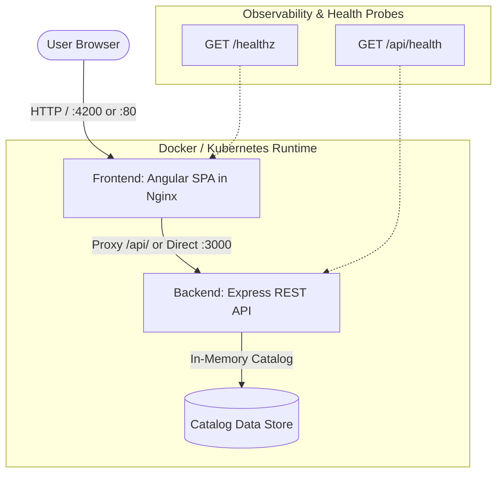

# ShopKart Application (`shopkart-app`)

ShopKart is a modern, cloud-native demo e-commerce application designed to teach end-to-end DevOps practices. It consists of an **Angular 22** Single Page Application (frontend) and a **Node.js 22 Express** REST API (backend), complete with multi-stage Docker configurations and production-grade Kubernetes manifests.

---

## 1. Architecture Overview



### Key Components

| Component | Technology | Port | Responsibilities |
| :--- | :--- | :--- | :--- |
| **Frontend** | Angular 22, TypeScript, Standalone Components | `4200` (Dev) / `80` (Prod) | Responsive catalog browsing, reactive shopping cart with signals, subtotal & tax calculation, checkout simulation. |
| **Backend** | Node.js 22, Express, CommonJS | `3000` | REST API endpoints for catalog (`/api/products`), single item lookups (`/api/products/:id`), pricing engine demo (`/api/cart-demo`), and health probes (`/api/health`). |
| **Docker** | Multi-stage Dockerfiles | - | Reproducible container builds using non-root users (`node`, unprivileged nginx) and built-in healthchecks. |
| **Kubernetes** | K8s Manifests & Kustomize | `30080` (NodePort) | Declarative deployments in namespace `shopkart-dev` with rolling updates, resource limits, and probes. |

---

## 2. Directory Structure

```text
shopkart-app/
├── backend/
│   ├── src/
│   │   ├── app.js            # Express application factory, routing & error handlers
│   │   ├── server.js         # HTTP server listener & graceful shutdown handlers
│   │   └── products.data.js  # Sample catalog data
│   ├── test/
│   │   └── api.test.js       # API integration tests using Node.js built-in test runner
│   ├── .env.example          # Environment variable template
│   └── package.json          # Node dependencies & run scripts
│
├── frontend/
│   ├── src/
│   │   ├── app/
│   │   │   ├── models/       # TypeScript interfaces (Product, CartItem, HealthStatus)
│   │   │   ├── services/     # ProductService with HttpClient & offline fallback
│   │   │   ├── app.ts        # Root component logic with Angular Signals
│   │   │   ├── app.html      # Responsive e-commerce UI & cart drawer template
│   │   │   ├── app.css       # Scoped modern styles & responsive layouts
│   │   │   └── app.spec.ts   # Frontend unit tests
│   │   ├── environments/     # Environment configurations (dev vs prod apiUrl)
│   │   ├── index.html        # HTML entry point
│   │   └── styles.css        # Global CSS variables & resets
│   ├── angular.json          # Angular CLI build & budget configuration
│   └── package.json          # Angular dependencies & build scripts
│
├── docker/
│   ├── Dockerfile.frontend   # Multi-stage Angular build + Nginx production runtime
│   ├── Dockerfile.backend    # Multi-stage minimal Node.js 22 LTS container (non-root)
│   ├── nginx.conf            # Nginx config with reverse proxy (/api/) & SPA fallback
│   └── docker-compose.yml    # Multi-container local development orchestration
│
├── k8s/
│   ├── namespace.yaml        # Namespace definition (shopkart-dev)
│   ├── configmap.yaml        # Application environment configuration
│   ├── backend-deployment.yaml # Express deployment (2 replicas, resources, probes)
│   ├── backend-service.yaml  # ClusterIP service on port 3000
│   ├── frontend-deployment.yaml# Nginx/Angular deployment (2 replicas, resources, probes)
│   ├── frontend-service.yaml # NodePort service on port 80 (NodePort 30080)
│   └── kustomization.yaml    # Kustomize manifest for single-command deployment
│
├── .gitignore                # Git exclusions (node_modules, dist, cache, etc.)
└── README.md                 # Application guide & documentation
```

---

## 3. Local Development Guide

### Prerequisites
- **Node.js**: v20+ or v22+ LTS (`node -v`)
- **npm**: v10+ (`npm -v`)
- **Docker & Docker Compose** (optional for containerized runs)
- **kubectl** (optional for Kubernetes manifest testing)

### Step 1: Run Backend API

```powershell
# Navigate to backend directory
cd Learning/shopkart-app/backend

# Install dependencies
npm install

# Run unit tests
npm test

# Start the server with hot-reload
npm run dev
# Or standard start
npm start
```
The backend starts at `http://localhost:3000`. You can verify:
- Health check: `curl http://localhost:3000/api/health`
- Products catalog: `curl http://localhost:3000/api/products`
- Cart demo calculation: `curl http://localhost:3000/api/cart-demo`

### Step 2: Run Frontend Application

In a separate terminal:

```powershell
# Navigate to frontend directory
cd Learning/shopkart-app/frontend

# Install dependencies (if not already installed)
npm install

# Start Angular development server
npm start
```
Open `http://localhost:4200` in your web browser. The frontend will automatically connect to `http://localhost:3000/api`. If the backend is stopped, the frontend gracefully falls back to mock catalog data so development is never blocked.

---

## 4. Docker Multi-Container Workflow

### Build and Run with Docker Compose

From the `shopkart-app/` root directory:

```powershell
# Build both images and start containers in the background
docker compose -f docker/docker-compose.yml up --build -d

# Inspect running containers and health status
docker compose -f docker/docker-compose.yml ps

# View real-time logs
docker compose -f docker/docker-compose.yml logs -f

# Access the application
# Frontend: http://localhost:4200
# Backend API: http://localhost:3000/api/health

# Stop and clean up containers
docker compose -f docker/docker-compose.yml down
```

### Manual Docker Build Commands

```powershell
# From shopkart-app root directory:

# 1. Build backend image
docker build -t shopkart-backend:local -f docker/Dockerfile.backend .

# 2. Build frontend image
docker build -t shopkart-frontend:local -f docker/Dockerfile.frontend .
```

---

## 5. Kubernetes Deployment (`k8s`)

The Kubernetes manifests are configured for the `shopkart-dev` namespace.

### Preparing Real Container Images

The manifests reference placeholder images:
- `ghcr.io/example-user/shopkart-frontend:latest`
- `ghcr.io/example-user/shopkart-backend:latest`

Before applying to a live cluster, tag and push your real images to your container registry (GitHub Packages, Docker Hub, AWS ECR, or Google Artifact Registry):

```powershell
# Authenticate to container registry (e.g. GitHub Container Registry)
echo $CR_PAT | docker login ghcr.io -u YOUR_GITHUB_USERNAME --password-stdin

# Tag images
docker tag shopkart-backend:local ghcr.io/YOUR_GITHUB_USERNAME/shopkart-backend:v1.0.0
docker tag shopkart-frontend:local ghcr.io/YOUR_GITHUB_USERNAME/shopkart-frontend:v1.0.0

# Push images
docker push ghcr.io/YOUR_GITHUB_USERNAME/shopkart-backend:v1.0.0
docker push ghcr.io/YOUR_GITHUB_USERNAME/shopkart-frontend:v1.0.0
```

### Deploying to Kubernetes

```powershell
# Validate all manifests locally using Kustomize without deploying
kubectl kustomize k8s/

# Deploy all manifests to the cluster
kubectl apply -k k8s/

# Monitor rollout status
kubectl rollout status deployment/backend -n shopkart-dev
kubectl rollout status deployment/frontend -n shopkart-dev

# View pods and services
kubectl get pods,services -n shopkart-dev

# Access the frontend service (NodePort or port-forward)
kubectl port-forward svc/frontend 8080:80 -n shopkart-dev
# Open http://localhost:8080
```

---

## 6. Implementation Decisions Explained

1. **Angular Signals**: Used Angular's reactive Signals (`signal()`, `computed()`) instead of complex external state management libraries (like NgRx). This provides predictable state transitions for the shopping cart and catalog filtering with zero boilerplate.
2. **Reverse Proxy in Nginx**: Rather than hardcoding hostnames into the frontend production JavaScript bundle, Nginx acts as a reverse proxy for `/api/`. Requests to `/api/*` are forwarded directly to `http://backend:3000/api/*` inside the container network.
3. **Non-Root Containers**: Both Dockerfiles implement non-root execution (`USER node` in Node.js, and unprivileged processes in Nginx) adhering to CIS Docker benchmark and enterprise security standards.
4. **Resilient Probes**: Express health endpoint `/api/health` and Nginx `/healthz` return lightweight status objects used by Kubernetes readiness and liveness probes to prevent traffic routing to unready pods.
